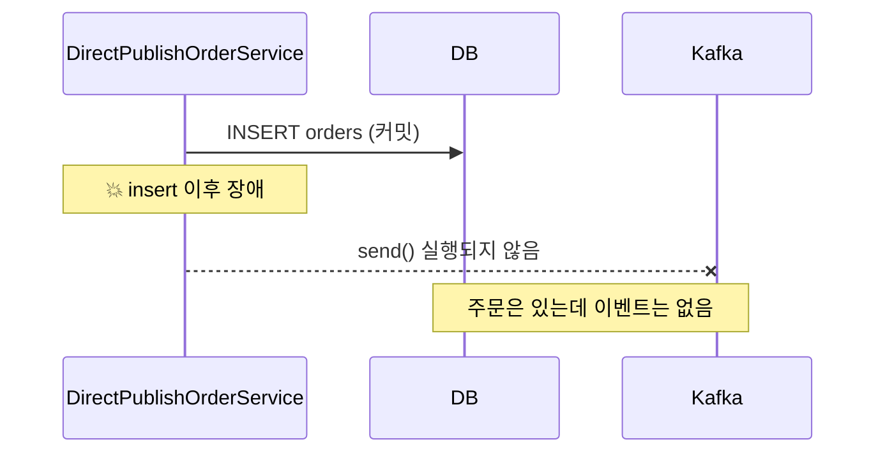
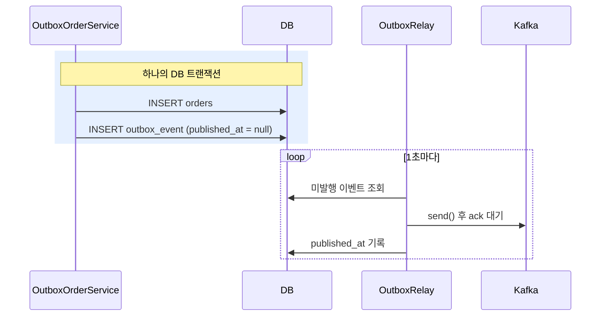

# outbox-pattern-example

Transactional Outbox 패턴을 **direct-publish**(Kafka 직접 발행)와 **outbox** 두 방식으로 나눠 비교하는 실습 프로젝트입니다.

- direct-publish: DB insert 후 Kafka로 직접 발행 → insert 이후 장애가 나면 **이벤트 누락**
- outbox: DB insert와 Outbox insert를 한 트랜잭션으로 묶고, 별도 Publisher가 Outbox를 읽어 발행 → **누락 없음**

## 구조

```
src/main/java/com/example/outbox/
├── scenario/                                # 비교 대상: direct-publish / outbox
│   ├── directpublish/
│   │   └── DirectPublishOrderService.java   # DB insert → Kafka 직접 발행
│   └── outbox/
│       ├── OutboxOrderService.java          # 주문 insert + Outbox insert (한 트랜잭션)
│       ├── OutboxEvent.java                 # Outbox 엔티티 (outbox_event 테이블)
│       ├── OutboxEventRepository.java
│       └── OutboxRelay.java                 # Outbox를 폴링해서 Kafka로 발행하는 별도 Publisher
│
│   # 아래는 두 케이스가 함께 쓰는 공통 부분
├── order/
│   ├── Order.java                           # 주문 엔티티 (orders 테이블)
│   ├── OrderRepository.java
│   └── OrderCreatedEvent.java               # Kafka로 보내는 이벤트
├── consumer/
│   └── OrderEventListener.java              # 이벤트 수신 측 (받은 이벤트를 메모리에 기록)
├── api/
│   └── OrderController.java                 # 실습용 REST API
├── config/                                  # 토픽, 스케줄링 설정
└── common/
    └── SimulatedFailureException.java       # "insert 이후 장애"를 흉내 내는 예외

src/main/resources/static/
└── index.html                               # 대시보드 (http://localhost:8081)

src/test/java/com/example/outbox/scenario/
├── directpublish/DirectPublishOrderServiceTest.java
└── outbox/OutboxOrderServiceTest.java
```

---

## 문제: Dual Write

"주문을 저장하고, 주문 생성 이벤트를 Kafka로 보낸다"처럼 **DB와 메시지 브로커 두 곳에 쓰는 것**을 Dual Write라고 합니다.
DB 트랜잭션은 Kafka까지 묶어 주지 못하므로, 두 쓰기 사이에 장애가 나면 둘 중 하나만 반영됩니다.

| 순서 | 중간에 장애가 나면 | 결과 |
|---|---|---|
| DB 커밋 → Kafka 발행 | 주문은 있는데 이벤트가 없음 | **이벤트 누락** (이 프로젝트의 direct-publish) |
| Kafka 발행 → DB 커밋 | 이벤트는 나갔는데 주문이 없음 | **유령 이벤트** |

`@Transactional`로 감싸도 해결되지 않습니다. Kafka 발행은 DB 롤백 대상이 아니기 때문에, 발행 후 커밋이 실패하면 두 번째 경우(유령 이벤트)가 됩니다.

## direct-publish: DB insert & Kafka 직접 발행



```java
public Order placeOrder(String productName, boolean failAfterInsert) {
    // 1. DB insert: save()가 끝나면 바로 커밋된다
    Order order = orderRepository.save(new Order(productName));

    // 2. insert와 produce 사이의 장애
    if (failAfterInsert) {
        throw new SimulatedFailureException();
    }

    // 3. Kafka produce: 2에서 예외가 나면 여기까지 오지 못해 이벤트가 누락된다
    kafkaTemplate.send(KafkaTopics.ORDER_CREATED_DIRECT, order.getId().toString(), OrderCreatedEvent.from(order).toString());
    return order;
}
```

`failAfterInsert`는 서버 다운, 네트워크 단절, 버그 같은 실제 장애를 흉내 내는 값입니다.
장애가 아니어도 **Kafka가 내려가 있으면** `send()`가 실패해서 같은 결과(주문은 저장, 이벤트는 누락)가 됩니다.

## outbox: DB insert & Outbox insert → 별도 Publisher



**1) 저장: 주문과 이벤트를 같은 트랜잭션으로**

```java
@Transactional
public Order placeOrder(String productName, boolean failAfterInsert) {
    // 1. DB insert: 트랜잭션 안이므로 아직 커밋되지 않는다
    Order order = orderRepository.save(new Order(productName));

    // 2. direct-publish와 같은 위치의 장애: 커밋 전이므로 1의 주문 insert도 롤백된다
    if (failAfterInsert) {
        throw new SimulatedFailureException();
    }

    // 3. Outbox insert: Kafka 대신 같은 트랜잭션으로 이벤트를 저장하고, 발행은 OutboxRelay가 한다
    outboxEventRepository.save(new OutboxEvent(
            "Order", order.getId().toString(), KafkaTopics.ORDER_CREATED_OUTBOX, OrderCreatedEvent.from(order).toString()));
    return order;
}
```

서비스는 Kafka를 전혀 모릅니다. 이벤트는 "보낼 것"으로 DB에 기록만 됩니다.

**2) 발행: Relay가 Outbox를 읽어서 Kafka로**

```java
@Scheduled(fixedDelayString = "${outbox.relay.fixed-delay-ms}")
@Transactional
public void publishPendingEvents() {
    for (OutboxEvent event : outboxEventRepository.findTop100ByPublishedAtIsNullOrderByIdAsc()) {
        try {
            kafkaTemplate.send(event.getTopic(), event.getAggregateId(), event.getPayload())
                    .get(5, TimeUnit.SECONDS);   // 브로커 ack를 받은 뒤에만 발행 완료로 표시
        } catch (Exception e) {
            return;                              // 남은 이벤트는 다음 주기에 재시도
        }
        event.markPublished();
    }
}
```

## 시나리오별 결과

대시보드의 세 표(`orders`, `outbox_event`, Kafka record) 기준입니다.

| 시나리오 | `orders` | `outbox_event` | Kafka record |
|---|---|---|---|
| direct-publish + 장애 | O | 안 씀 | X → 불일치 & 누락 |
| direct-publish (장애 없음) | O | 안 씀 | O → 불일치 없음(정상) |
| outbox + 장애 | X (롤백) | X | X → 불일치 없음(정상) |
| outbox (장애 없음) | O | O | O → 불일치 없음(정상) |
| outbox + Kafka 다운 | O | O (`published_at`이 `-`로 남음) | X → 일시적 불일치 |
| ↳ Kafka 복구 후 | O | O (`published_at` 기록) | O → 불일치 없음(정상) |

direct-publish는 장애 한 번으로 주문과 이벤트가 영구히 어긋나고, outbox는 롤백되거나 Relay가 결국 발행해서 정합성이 맞춰집니다.

단, outbox도 Kafka 발행 직후 `published_at` 기록 전에 장애가 나면 다음 주기에 **한 번 더 발행**됩니다. 누락은 없지만 중복은 생길 수 있으므로 Consumer의 멱등 처리가 필요합니다. ([실무 고려 사항](#정리-및-실무-고려-사항) 참고)

## 실행

테스트, 직접 실행(대시보드), API 목록은 [docs/how-to-run.md](docs/how-to-run.md)를 참고하세요.

---

## 정리 및 실무 고려 사항

- **At-least-once**: Outbox는 누락은 막지만 중복은 생길 수 있습니다. Consumer는 이벤트 ID(또는 주문 ID)로 **멱등 처리**해야 합니다.
- **순서**: Relay는 id 순으로 발행하고, 실패하면 그 자리에서 멈춰 뒤 이벤트가 앞질러 가지 않게 합니다. 키를 주문 ID로 두면 같은 주문의 이벤트는 같은 파티션에서 순서가 유지됩니다.
- **다중 인스턴스**: 애플리케이션이 여러 대면 Relay가 같은 이벤트를 동시에 읽을 수 있습니다. `SELECT ... FOR UPDATE SKIP LOCKED`나 ShedLock 같은 분산 락으로 한 곳에서만 발행하게 합니다.
- **Outbox 정리**: 발행이 끝난 행은 주기적으로 삭제하거나 보관 테이블로 옮깁니다.
- **폴링 대신 CDC**: 이 프로젝트는 폴링 방식(Polling Publisher)입니다. Debezium 같은 CDC로 DB 로그(binlog, WAL)를 읽어 발행하면 폴링 지연과 DB 부하를 줄일 수 있습니다.
