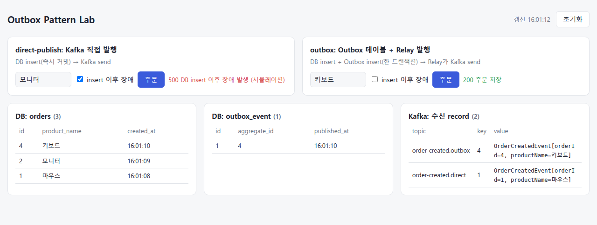

# 실행 방법

[← README](../README.md)

## 환경

| 항목 | 버전 / 위치 |
|---|---|
| Java | 21 |
| Spring Boot | 3.5 |
| DB | H2 인메모리 (`jdbc:h2:mem:outbox`) |
| Kafka | 3.9 (docker compose, `localhost:19092`) |
| 애플리케이션 | `http://localhost:8081` |

## 테스트 (Kafka 설치 불필요)

`@EmbeddedKafka`로 테스트 안에서 Kafka를 띄웁니다.

```bash
./gradlew test
```

| 테스트 | 검증 내용 |
|---|---|
| `DirectPublishOrderServiceTest` | 장애 없음 → 주문과 이벤트 모두 반영 |
| | **insert 이후 장애 → 주문은 저장, 이벤트는 누락** |
| `OutboxOrderServiceTest` | 주문 + Outbox 저장 후 Relay가 발행 |
| | **insert 이후 장애 → 주문이 롤백되어 주문도 이벤트도 없음** |
| | Kafka 발행 실패 → Outbox에 남아 있다가 다음 시도에 발행 |

## 직접 실행

```bash
docker compose up -d   # Kafka (localhost:19092)
./gradlew bootRun      # http://localhost:8081
```

### 대시보드 테스트

브라우저에서 http://localhost:8081 을 엽니다. (`src/main/resources/static/index.html`)

**화면 구성**



> 캡처 시나리오: 마우스(direct-publish, 장애 없음) → 모니터(direct-publish + 장애) → 모니터(outbox + 장애) → 키보드(outbox, 장애 없음)
> - `orders`: 1(마우스), 2(모니터), 4(키보드). outbox 장애 주문(3)은 롤백되어 없음
> - Kafka record: 1, 4만 있음. direct-publish 장애 주문(2)은 **주문은 있는데 record가 없음** → 누락

방식·장애별로 세 표가 어떻게 달라지는지는 [README의 시나리오별 결과](../README.md#시나리오별-결과)를 참고하세요.
Kafka 다운은 `docker compose stop kafka`, 복구는 `docker compose start kafka`로 재현합니다.

### API

| API | 설명 |
|---|---|
| `POST /direct-publish/orders` | direct-publish 주문 (Kafka 직접 발행) |
| `POST /outbox/orders` | outbox 주문 (Outbox 테이블 + Relay 발행) |
| `GET /orders` | 저장된 주문 |
| `GET /outbox-events` | Outbox 테이블 |
| `GET /received-events` | Consumer가 받은 이벤트 |
| `DELETE /data` | 주문, Outbox, 수신 이벤트 초기화 |

주문 API는 `?failAfterInsert=true`를 붙이면 DB insert 직후 장애를 일으킵니다. 생략하면 `false`입니다.

```bash
curl -X POST 'localhost:8081/outbox/orders?failAfterInsert=true' \
     -H 'Content-Type: application/json' -d '{"productName":"키보드"}'
```

H2 콘솔: http://localhost:8081/h2-console (JDBC URL `jdbc:h2:mem:outbox`)
